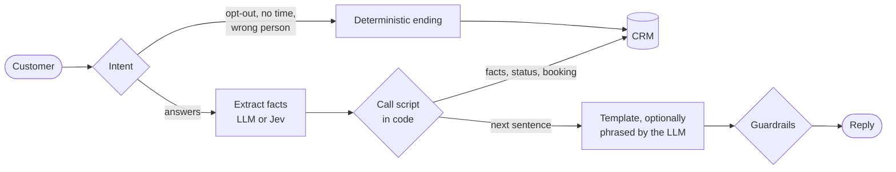

# ai-call-agent


A voice agent that calls solar leads within minutes of their web inquiry, qualifies them in four questions
and books a consultation.
I built it the way I would run a customer deployment: scoping first, business rules in code, an acceptance
test against simulated customers, and an integration layer against the public [telli](https://docs.telli.com)
API so the agent can talk to a CRM, a calendar and a ticketing system.

The customer (SonnenWerk Energie), the leads and all transcripts are made up. The agent speaks German.

## Result

Ten customer personas (owner, tenant, apartment building, "call me tomorrow", polite no, persistent price
asker, wrong person, vague answers, aggressive), each with an expected outcome checked against the CRM state,
not against what the model says.

| Run | What changed | Passed |
| --- | --- | --- |
| Baseline | Rules only in the prompt, the model drives the call with tool calling | 1 / 10 |
| Guardrails | Code blocks bookings the model claims but never made (62 blocked claims in 10 calls) | 1 / 10 |
| Guided v1 | The call script becomes a state machine; the model only extracts facts and phrases sentences | 4 / 10 |
| Guided v4 | A rule reads the answer to the question just asked before the model sees it | 10 / 10 |
| Guided v5 | 5 runs per persona, stricter checks on the model's phrasing | **49 / 50** |

Qwen 2.5 7B runs locally for both agent and simulated customer. In v5 the average call took 2.7 turns at
4.3 s per turn with zero tool errors, and the price asker never got a price. The one failure was the test's
fault: the "aggressive" customer said "I don't have time, call me later" and the agent scheduled a callback.

What the baseline showed is the reason the project looks the way it does. A 7B model told a tenant he
qualified, announced appointments it had never looked up (29 blocked claims in one call) and printed tool
names as text. Guardrails stop the damage but do not finish the call. So control flow moved into code.

## How it works



- **The model phrases, the code decides.** Whether a lead qualifies, whether a slot can be booked and how a
  call ends is checked against the CRM. `book_appointment` refuses tenants and slots that were never offered,
  whatever the prompt says.
- **Every claim is checked against tool state.** A reply that mentions a booking without a successful
  `book_appointment`, or a time without `check_slots`, is thrown away and the template is spoken instead.
- **Classification instead of generation where possible.** [Jev](https://docs.litellm.ai/blog/typesafe_jev)
  (TypeSafe AI) returns typed choices with confidences, not text. It routes intent before the LLM and can
  take over fact extraction (ownership, building type, chosen slot). Numbers come from rules. Below a
  confidence of 0.70 the agent asks again rather than disqualifying someone on a weak signal.
- **No LLM at all, if you want.** `--no-llm` combines Jev extraction with template sentences. The agent then
  makes zero LLM calls per turn. The tests prove it; a logged acceptance run in this mode is still to do.

## Integration layer

The conversation is half of a deployment. [`integrations/`](integrations) is the other half, built from
telli's public documentation and tested against a platform simulator, since I have no account:

- **CRM to dialer:** create contacts and schedule calls, idempotent and safe on 409.
- **During the call:** custom tools (`lookup_lead`, `book_appointment`, `create_ticket`, …) and a custom
  calendar, all signature-checked, all running the same business rules as the agent.
- **After the call:** the `call_ended` webhook derives the outcome from backend state, not from the agent's
  claim. "Booked" without a booking becomes a review task.
- **Out to customer systems:** HubSpot, Salesforce and Cal.com adapters, and an outbox with retries and a
  dead letter queue.
- **Operations:** KPIs as code, a daily transcript review, Prometheus metrics, retention rules with
  GDPR access and deletion per phone number, Docker, and a load test in CI (40 calls, 10 in parallel).
- **Go/no-go check:** `python -m integrations check --url …` sends the platform's own requests to a staging
  backend and writes an acceptance report.

Two use cases share one backend: outbound solar qualification and an inbound telecom case with caller
verification and a 24-hour change cutoff. Each is defined once and generates the builder config
(prompt, outcomes, tools) in [`docs/telli-konfig/`](docs/telli-konfig).

The deployment playbook in [`docs/playbook/`](docs/playbook) covers the path from signed contract to first live
call: scoping workshop, integration checklist, UAT, go-live runbook, KPIs, escalation, handover.

## Run it

Python 3.11+, [Ollama](https://ollama.com/download) and about 5 GB of memory for Qwen 2.5 7B.

```bash
git clone https://github.com/jonathankuhn11-spec/ai-call-agent.git && cd ai-call-agent
python -m venv .venv && source .venv/bin/activate
pip install -r requirements.txt && ollama pull qwen2.5:7b

python agent.py --guided                 # you play the customer
python simulate.py --label "my run"      # acceptance test, all personas
python -m integrations demo              # five pilot calls through the simulated platform
python -m pytest -q                      # 297 tests, no Ollama, Jev or account needed
```

Jev is optional: put `TYPESAFE_API_KEY=…` in `.env`, then `python simulate.py --no-llm`. Without a key the
same decisions fall back to regex rules. `python voice.py` adds local speech (faster-whisper in, Piper out,
push-to-talk). All commands are listed in the [detailed docs](docs/README.de.md#reproduzieren).

## Limits

- No telephony. The voice layer runs on a laptop; SIP, barge-in and streaming TTS are missing.
- The simulated customer is the same small model as the agent, so it can hide errors as well as create them.
- 50 calls is a usable sample, not a large one.
- Jev is a US cloud service. Real calls would need a data processing agreement and a transfer assessment
  (see [`SCOPING.md`](SCOPING.md), section 8).
- The integration layer has never seen a real telli, HubSpot or Cal.com account.

## More

- [`SCOPING.md`](SCOPING.md): problem, KPIs, qualification criteria, edge cases, legal, pilot plan
- [`docs/README.de.md`](docs/README.de.md): every design decision, the full iteration log, all commands (German)
- [`docs/integrationen.md`](docs/integrationen.md): interfaces, payloads, signatures, outcome table (German)

MIT licensed.
