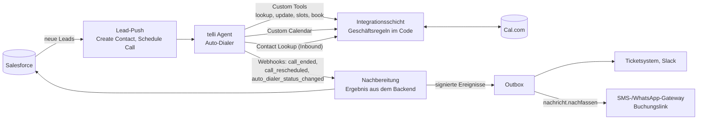

# Deployment-Case: Ein Enterprise-Rollout auf telli, end to end

Dieses Dokument zeigt an einem durchgerechneten Fall, wie ich als Deployment Strategist einen
Enterprise-Kunden auf telli live bringen würde: vom Business Case über Integration und Abnahme bis
zum Hochfahren. Jeder Schritt verweist auf das Artefakt in diesem Repository, das ihn umsetzt.
Der Kunde ist fiktiv, die Zahlen sind als **Annahmen** markiert und werden im Pilot gemessen.

## 1. Ausgangslage

**Kunde (fiktiv):** Energieversorger mit PV- und Wärmepumpen-Vertrieb, rund 3.000 Online-Leads im Monat,
Inbound-Service-Hotline mit Lastspitzen, CRM Salesforce, Kalender Cal.com, Ticketsystem per Webhook.

| Problem | Heute (Annahme) | Ursache |
| --- | --- | --- |
| Leads kühlen ab | Median Rückruf 4 Stunden, Erreichbarkeit 45 % | Vertrieb ruft in Blöcken zurück |
| Vertrieb telefoniert mit Unpassenden | 60 bis 70 % der Gespräche ohne Ergebnis | Mieter, Mehrfamilienhäuser, kein Interesse |
| Nie Erreichte gehen verloren | 55 % der Leads, danach eine manuelle Aufgabe | Telefon ist der einzige Kanal |
| Service-Hotline läuft über | Terminänderungen blockieren Agenten | Kein Self-Service für Standardfälle |

## 2. Business Case

Rechnung je Monat; Erreichbarkeit mit Agent und Fallback-Quoten sind Annahmen, die der Pilot bestätigt oder korrigiert.

| Stufe | Heute | Mit Agent (Anruf unter 5 Minuten) | Herleitung |
| --- | ---: | ---: | --- |
| Leads | 3.000 | 3.000 | |
| erreicht | 1.350 | 1.950 | 45 % heute, 65 % bei Speed-to-Lead unter 5 Minuten (Annahme) |
| qualifiziert | 1.080 | 1.560 | 80 % der Erreichten (Pilot-Ziel aus [`SCOPING.md`](../SCOPING.md)) |
| Termine aus dem Anruf | 378 | 546 | 35 % der Qualifizierten (Pilot-Ziel) |
| Termine aus dem Kanal-Fallback | 0 | 34 | 1.050 nie Erreichte × 40 % mit SMS-Einwilligung × 8 % Buchung (Annahme) |
| **Termine gesamt** | **378** | **580** | **+202 Termine, +53 %** |

Bei 20 % Abschlussquote je Beratungstermin und 4.000 € Deckungsbeitrag je Anlage (Annahmen des Kunden) sind
das rund **160.000 € zusätzlicher Deckungsbeitrag im Monat**, bevor die gesparte Vertriebszeit eingerechnet ist.
Die Rechnung ist so gebaut, dass jede Zeile eine KPI aus dem Wochenreport ist: Wenn eine Annahme nicht hält,
sieht man im Pilot genau, welche.

## 3. Architektur: welche telli-Bausteine wofür

| telli-Baustein | Umsetzung im Repo | Warum so |
| --- | --- | --- |
| Create Contact, Schedule Call | [`integrations/telli.py`](../integrations/telli.py) (Lead-Push im Takt von 60 s) | Speed-to-Lead ist der größte Hebel im Business Case |
| Custom Tools | [`integrations/server.py`](../integrations/server.py), Definitionen unter `/tools/definitions` | Das Modell darf vorschlagen, der Code entscheidet (Buchung nur für Qualifizierte) |
| Custom Calendar | [`integrations/kalender.py`](../integrations/kalender.py) mit Cal.com-Adapter | Slots in Ortszeit, Schnittstelle in UTC, Doppelbuchungen ausgeschlossen |
| Contact Lookup | `/webhooks/contact-lookup`, dazu PLZ-Verifizierung als Custom Tool | Inbound: keine Termindaten vor der Identitätsprüfung |
| Webhooks | [`integrations/nachbereitung.py`](../integrations/nachbereitung.py), Svix-Signatur, Dedup, Transaktion | Das Ergebnis eines Anrufs kommt aus CRM und Kalender, nicht aus der Behauptung des Agenten |
| Kanal-Fallback | [`integrations/nachfass.py`](../integrations/nachfass.py) | Aus dem Voice-Agenten wird eine Kundeninteraktion über mehrere Kanäle |
| CRM-Anbindung | [`integrations/salesforce.py`](../integrations/salesforce.py), [`integrations/hubspot.py`](../integrations/hubspot.py) | Das Kunden-CRM bleibt führendes System |
| Konfiguration im Builder | [`docs/telli-konfig/`](telli-konfig) erzeugt aus dem Use Case | Prompt, Tools, Outcomes und Testszenarien versioniert statt geklickt |

## 4. Ablauf in vier Wochen

| Woche | Was passiert | Abnahmekriterium | Artefakt |
| --- | --- | --- | --- |
| 0 | Scoping-Workshop mit Vertriebsleitung, IT und Datenschutz | Scoping unterschrieben, KPIs mit Baseline | [Playbook 01](playbook/01-scoping-workshop.md), [`SCOPING.md`](../SCOPING.md) |
| 1 | Integration gegen Staging, echte Webhook-Zustellungen | `python -m integrations check` ergibt Go | [Playbook 02](playbook/02-integrations-checkliste.md) |
| 1 bis 2 | UAT: Personas, Edge Cases, Transkript-Review mit dem Fachbereich | mindestens 90 % bestanden, 100 % bei Buchungs- und Opt-out-Personas | [Playbook 03](playbook/03-uat-abnahmekriterien.md), [`simulate.py`](../simulate.py) |
| 2 bis 4 | Soft-Launch mit 10 % der Leads, Hochfahren nach Kriterien | Hochfahr-Kriterien zwei Wochen in Folge erfüllt | [Playbook 04](playbook/04-go-live-runbook.md), [Playbook 05](playbook/05-kpis-und-reporting.md) |
| 4 | Übergabe an den Kunden, Deployment im zweiten Glied | Kunde ändert Leitfaden und Slots selbst | [Playbook 07](playbook/07-enablement.md) |

## 5. Risiken und was dagegen gebaut ist

| Risiko | Gegenmaßnahme | Nachweis |
| --- | --- | --- |
| Agent behauptet Buchungen, die es nicht gibt | Faktencheck gegen Tool-Zustand, Nachbereitung aus dem Backend, Flag bei Widerspruch | `tests/test_guardrails.py`, `tests/test_integrations_nachbereitung.py` |
| Webhook geht verloren oder kommt doppelt | Dedup je Nachricht und Anruf, Abgleich mit List Calls alle 30 Minuten | `integrations/abgleich.py` |
| Kundensystem ist langsam oder down | Outbox mit Wiederholplan, Lasttest mit langsamem Empfänger in CI | `scripts/lasttest.py` |
| Opt-out wird übergangen | Opt-out wird nie überstimmt, Sperrliste gilt für Anruf und Nachricht | `tests/test_integrations_nachfass.py` |
| SMS ohne Rechtsgrundlage | Einwilligung je Kanal im Code erzwungen, Zustellfenster in Ortszeit | `integrations/nachfass.py` |
| Löschersuchen nach Art. 17 DSGVO | Löschung je Telefonnummer inklusive Nachfass-Verlauf, Nummer bleibt als Werbesperre | `integrations/aufbewahrung.py` |
| KI-Transparenz (AI Act, Art. 50) | Begrüßung nennt die digitale Assistentin, Prüfung im UAT | Use-Case-Konfiguration |

## 6. Wie ich die ersten 90 Tage bei telli angehen würde

- **Tage 1 bis 30: lernen und mitlaufen.** In zwei laufenden Deployments mitarbeiten, Transkripte und
  Webhook-Logs lesen, die häufigsten Ursachen für Verzögerungen zwischen Unterschrift und Go-live sammeln.
  Ein Deployment-Schritt, der wiederkehrend Handarbeit kostet, wird als Werkzeug oder Vorlage für das Team gebaut.
- **Tage 31 bis 60: ein Deployment selbst führen.** Scoping bis Go-live bei einem Kunden, mit messbarer
  Baseline und Wochenreport; Rückmeldungen aus dem Feld strukturiert an Produkt und Engineering.
- **Tage 61 bis 90: skalieren.** Wiederverwendbare Bausteine für eine Branche (zum Beispiel Energie:
  Marktkommunikation, Lieferantenwechsel, Zählerstände), damit das nächste Deployment dieser Art in der
  Hälfte der Zeit live geht.

## 7. Rollenprofil und Nachweis

| Erwartung an die Rolle | Nachweis |
| --- | --- |
| Hands-on mit echten Agent-Deployments | Zwei Use Cases (Outbound PV, Inbound Telko) auf einem Backend, [`integrations/usecases/`](../integrations/usecases) |
| Strategische und technische Umsetzung gestalten | Scoping, Business Case (dieses Dokument), Playbook in sieben Phasen |
| Eng mit Sales und Engineering arbeiten | Scoping-Workshop-Vorlage, Eskalationsmatrix, Feldfeedback als Teil des Wochenreports |
| Kundennah und technisch versiert | Integrationsschicht mit 300+ Tests, 95 % Abdeckung, Docker, Lasttest, Abnahme von außen |
| Mit KI-Tools automatisieren, was das Team bremst | Konfigurationspakete aus Code, automatisierter UAT mit simulierten Kunden, Go/No-Go per Kommando |
