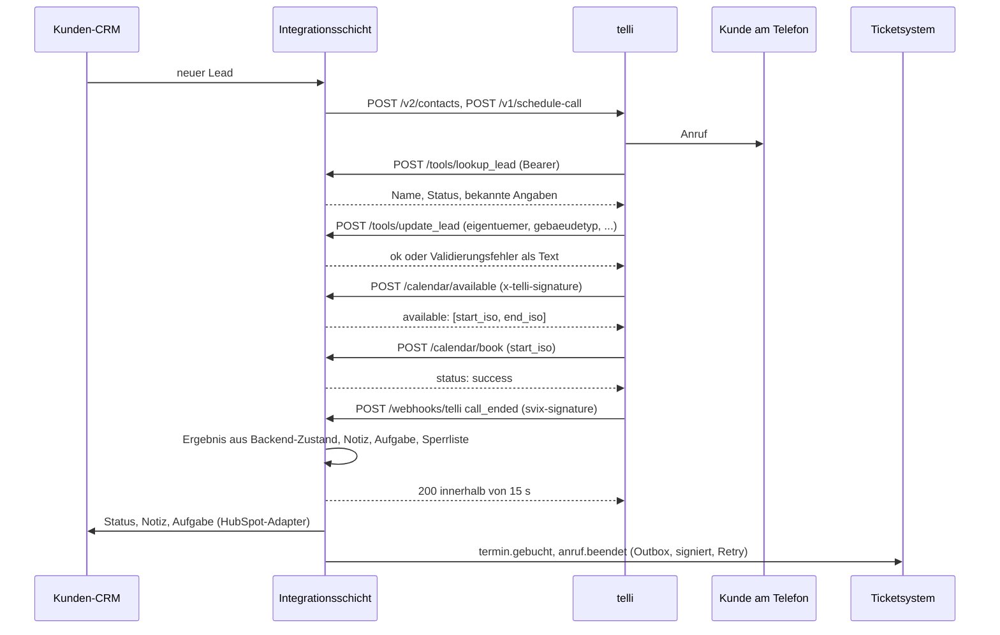

# Integrationsschicht: Der Agent im Tech-Stack des Kunden

Das Gespräch ist die halbe Miete. Die andere Hälfte eines Deployments ist alles drumherum: Leads
aus dem CRM in den Dialer, Backend-Funktionen für den Agenten während des Gesprächs, Ergebnisse
zurück ins CRM, Aufgaben für Rückrufe, Benachrichtigungen an nachgelagerte Systeme. Das Paket
[`integrations/`](../integrations) baut diese Hälfte entlang der dokumentierten Schnittstellen
der Voice-Plattform [telli](https://docs.telli.com). Es läuft komplett lokal gegen das Mock-CRM
in DuckDB; ein Simulator spielt die Plattform.

| Richtung | Schnittstelle (telli-Doku) | Endpunkt / Modul |
| --- | --- | --- |
| CRM → Plattform | Create Contact v2, Schedule Call v1 | `telli.py` (`LeadPush`) |
| Plattform → Backend, Abgleich | List Calls, Get Call | `abgleich.py` (Webhook-Lücken schließen) |
| Plattform → Backend, im Gespräch | Custom Tools (HTTP-Function-Tools) | `POST /tools/{name}` |
| Plattform → Backend, im Gespräch | Custom Calendar (`/available`, `/book`) | `POST /calendar/available`, `POST /calendar/book` |
| Plattform → Backend, vor dem Gespräch | Contact Lookup Webhook | `POST /webhooks/contact-lookup` |
| Plattform → Backend, nach dem Gespräch | Webhooks `call_ended`, `call_rescheduled`, `auto_dialer_status_changed`, Svix-signiert | `POST /webhooks/telli` → `nachbereitung.py` |
| Backend → Kundensysteme | eigene Ereignisse, Svix-signiert, Outbox | `outbox.py` |
| Backend → Kunden-CRM | HubSpot CRM API v3 oder Salesforce REST API (Kontakt/Lead, Notiz, Aufgabe) | `hubspot.py`, `salesforce.py` |
| Backend ↔ Kalenderdienst | Cal.com API v2 (`/v2/slots`, `/v2/bookings`, `/cancel`): Verfügbarkeit gespiegelt, Buchung bestätigt, Absage nachgezogen | `kalender.py` (Abschnitt 3a) |
| Builder ← Backend | Prompt, Outcomes, Properties, Tools, Kalender, Webhook je Use Case | `usecases/`, `konfigpaket.py` → `docs/telli-konfig/` |
| Abnahme ← Backend | dieselben Requests wie die Plattform, von außen, als Go/No-Go | `pruefung.py` (`python -m integrations check`, Abschnitt 10) |

## Ein Pilotgespräch, Ende zu Ende



`python -m integrations demo` fährt genau diesen Ablauf mit fünf Personas im Prozess, ohne Account
und ohne Netz, und druckt CRM-Zustand, Latenzen und die beim Attrappen-Ticketsystem angekommenen,
signaturgeprüften Ereignisse. In CI läuft die Demo bei jedem Push.

## Grundsätze

**Der Code entscheidet, auch gegenüber der Plattform.** Jede Buchung und jede Statusänderung läuft
durch `agent.Tools` mit denselben Geschäftsregeln wie im lokalen Agenten: qualifiziert heißt
Eigentümer und bekannter Gebäudetyp, kein Mehrfamilienhaus; gebucht wird nur ein Termin, der diesem
Lead angeboten wurde und noch frei ist. Die Nachbereitung leitet das Gesprächsergebnis aus dem
Zustand des Backends ab, nicht aus der Behauptung des Agenten.

**Gesprächszustand liegt in der Datenbank.** Jeder Tool-Aufruf der Plattform ist ein eigener
HTTP-Request ohne Gedächtnis. Was dem Lead angeboten wurde, steht deshalb in der Tabelle `angebote`
(`PersistenteTools` in `crm.py`), nicht im Prozess. Der Server ist damit neustartfest. Die
Nachbereitung eines Anrufs ist eine Transaktion: Statusänderung, Notiz, Aufgabe, Sperrvermerk,
Protokoll, Ereignisse und der Dedup-Eintrag stehen zusammen in der Datenbank oder gar nicht.

**Wiederholungen sind ungefährlich.** Die Plattform wiederholt Webhooks nach jedem Nicht-2xx und
kann Tool-Aufrufe nach einem Timeout erneut stellen (für Custom Tools dokumentiert telli kein
Wiederholungsverhalten, der Agent selbst darf es aber jederzeit noch einmal versuchen). Deshalb ist jede Buchung idempotent (derselbe Lead, derselbe Slot:
derselbe Erfolg; ein anderer Slot: Umbuchung, der alte wird frei), jeder `call_ended`-Webhook wird
über Nachrichten-ID und Call-ID dedupliziert, und jedes ausgehende Ereignis trägt einen
Idempotency-Key.

**Tolerant lesen, strikt schreiben.** Payloads der Plattform werden mit `extra="ignore"` gelesen;
neue Felder bei telli brechen nichts. Was diese Schicht antwortet oder sendet, ist exakt nach
Kontrakt geformt (`extra="forbid"`, Zeitformate, Feldnamen).

**Fehler dorthin, wo sie verwertet werden.** Fehler, die der Agent im Gespräch verwerten kann
(Lead unbekannt, Termin nicht mehr frei, Validierung), kommen mit HTTP 200 und Klartext im Body
zurück, damit sie das Sprachmodell erreichen. Konfigurationsfehler (unbekanntes Tool, kaputtes
JSON, falsche Signatur) sind 4xx und landen im Plattform-Log.

**Eine Uhr.** Jeder Zeitvergleich der Schicht (freie Slots, fällige Erinnerungen, Mindestvorlauf,
Gesprächsfenster, Wiederholungspläne, Replay-Schutz der Signaturen) läuft über eine Uhr, die beim
Aufbau der App übergeben wird (`uhr.py`); die Datenbankfunktion `now()` wird nicht benutzt, weil
sie sich nicht stellen lässt. Produktiv ist das die Systemzeit in UTC; in den Tests steht sie und
wird vorgestellt: Ein Test, der prüft, dass eine Erinnerung genau 24 Stunden vor dem Termin
rausgeht, stellt die Uhr vor, statt Zeitstempel in der Datenbank zu verbiegen. Dieselbe Suite läuft
am Sonntagabend, in der Nacht und in der Nacht der Zeitumstellung identisch
(`tests/test_integrations_uhr.py`); die Tabellen speichern Wanduhrzeit der konfigurierten Zone,
die Plattform spricht UTC, die Umrechnung liegt an einer Stelle (`LocalCRM.wandzeit`, `start_utc`).

## 1. Lead-Push: CRM → Dialer

Speed-to-Lead (Ziel unter 5 Minuten, `SCOPING.md`) entscheidet sich hier. `LeadPush.synchronisieren()`
läuft im Hintergrundplaner des Servers (`PUSH_TAKT_S`, Standard 60 s) und auf Zuruf über
`POST /push`, zum Beispiel aus einem CRM-Webhook heraus:

1. Offene Leads ohne telli-Kontakt und ohne Sperrvermerk auswählen.
2. `POST /v2/contacts` (camelCase, `externalId` = Lead-ID, Eigenschaften `quelle`, `plz`, bekannte
   Qualifizierungsfelder). Die Eigenschaften müssen bei telli unter *Settings → Contact properties*
   angelegt sein, sonst werden sie ignoriert.
3. `POST /v1/schedule-call` mit `contact_id` und `agent_id`, optional `max_retry_days`.
4. Kontakt-ID und `loop_id` in `telli_kontakte` speichern.

Idempotent: Wer einen Kontakt hat, wird nicht erneut angelegt; wer einen Kontakt, aber keinen
Anruf hat (Dialer war aus), wird beim nächsten Lauf nachgeholt. Antwortet telli mit
`409 DUPLICATE_EXTERNAL_ID`, wird der Lead einmal gemeldet und zur manuellen Zuordnung vorgemerkt
(`zuordnung_offen()`), nicht bei jedem Lauf neu versucht. `python -m integrations push --trocken`
zeigt die Requests, ohne zu senden.

## 2. Custom Tools: Backend-Funktionen im Gespräch

telli ruft je Custom Tool eine HTTPS-URL mit konfigurierbarem Body auf; der Body besteht aus
Konstanten, System Variables, LLM-Parametern und Secrets. `GET /tools/definitions` (oder
`python -m integrations definitions`) erzeugt die Konfiguration je Tool:

| Body-Schlüssel | Value Type in telli | Wert |
| --- | --- | --- |
| `call_id` | System Variable | `call.id` |
| `external_id` | System Variable | `contact.externalId` |
| `phone_number` | System Variable | `contact.phoneNumber` |
| `status`, `eigentuemer`, `gebaeudetyp`, `dachflaeche_m2`, `jahresverbrauch_kwh`, `notiz`, `slot_id`, `art` | LLM Parameter | aus `agent.TOOL_SCHEMAS`, Datentyp String / Number / Boolean |
| `grund` (cancel_appointment), `plz` (verify_customer), `kategorie`, `beschreibung` (create_ticket) | LLM Parameter | aus `EIGENE_SCHEMAS` in `server.py` |
| Header `Authorization` | Secret | `Bearer <TOOL_SECRET>` |

Sieben Tools stehen bereit, je Use Case eine Auswahl (`usecases/`): `lookup_lead` (Bekanntes nicht
erneut fragen, nennt den nächsten Termin), `update_lead`, `check_slots`, `book_appointment`,
`cancel_appointment` (Absage oder Umbuchung, der Slot wird frei, die Absage bleibt Historie),
`verify_customer` (Identitätsprüfung über die Postleitzahl, höchstens drei Versuche je Anruf) und
`create_ticket` (Störung oder Anliegen mit Ticketnummer, Ereignis an das Ticketsystem). `end_call`
gibt es über HTTP nicht: Das Gesprächsende ist Sache der Plattform, das Ergebnis kommt per
`call_ended`. Zwei Regeln sind Konfiguration des Use Case und werden vom Server erzwungen, nicht
vom Prompt erbeten: Mit `VERIFIZIERUNG_PFLICHT` gibt kein Tool außer `verify_customer` Daten
heraus, bevor der Anrufer für diese `call_id` verifiziert ist; mit `MINDESTVORLAUF_H` lehnt
`cancel_appointment` Termine ab, die näher liegen (der Techniker ist eingeplant), und meldet
`weiterleiten: true`. Der Lead wird über `external_id` aufgelöst,
ersatzweise über die normalisierte Telefonnummer. `book_appointment` ist idempotent (Wiederholung
nach Timeout: derselbe Erfolg) und behandelt einen zweiten Slot als Umbuchung; ein Lead hält
höchstens einen Termin. Ein Fakt, der der Qualifizierung widerspricht (ein qualifizierter Lead
sagt, er sei Mieter), wird gespeichert und setzt die Qualifizierung zurück, statt verworfen zu
werden. Jeder Aufruf wird mit Latenz gemessen
(`GET /metrics`); überschreitet ein Tool das Budget (`TOOL_LATENZBUDGET_MS`, Standard 800 ms),
wird es geloggt. telli bricht Tool-Aufrufe nach dem konfigurierten Timeout (1 bis 10 s) ab.

Beispiel:

```http
POST /tools/update_lead
Authorization: Bearer <TOOL_SECRET>
{"call_id": "c_1", "external_id": "3", "phone_number": "+49251000003",
 "status": "in_qualifizierung", "eigentuemer": true, "gebaeudetyp": "DHH"}

200 {"ok": true, "gespeichert": {"status": "in_qualifizierung", "eigentuemer": true, "gebaeudetyp": "doppelhaushaelfte"}}
```

## 3. Custom Calendar: der telli-Kalenderkontrakt

telli kann die Terminbuchung selbst führen und ruft dafür zwei Endpunkte auf. Beide antworten immer
mit HTTP 200; Erfolg oder Misserfolg steht im Body. Zeiten sind UTC, ISO 8601 mit Millisekunden
und `Z`; `start_iso` ist der Slot-Bezeichner.

| Endpunkt | Request (von telli) | Antwort |
| --- | --- | --- |
| `POST /calendar/available` | `contact` (V2-Objekt mit `externalId`, `phoneNumber`, `timezoneIana`), dazu `contact_id`, `external_contact_id`, `contact_details` (V1) | `{"available": [{"start_iso": "...", "end_iso": "..."}]}` |
| `POST /calendar/book` | dasselbe plus `start_iso` | `{"status": "success"}` oder `{"status": "failed", "reason": "Appointment slot is no longer available"}` |

Regeln dahinter: `/available` liefert nur für qualifizierte Leads Slots (sonst eine leere Liste;
der Grund steht im Server-Log, der Body bleibt exakt der Kontrakt) und merkt sich die angebotenen
Slots je Lead 24 Stunden. `/book` ist idempotent: Derselbe Lead, derselbe Slot, zweiter Aufruf nach
einem Timeout ergibt wieder `success`, keine zweite Buchung; ein anderer Slot ist eine Umbuchung.
Belegte oder unbekannte Slots antworten mit dem Standardgrund, nie angebotene oder nicht
qualifizierte mit dem Grund aus der Geschäftsregel.
Beide Endpunkte verlangen `x-telli-signature` (HMAC-SHA256 über den rohen Body, Schlüssel ist
der API-Key), sobald `TELLI_API_KEY` gesetzt ist.

## 3a. Kalenderdienst hinter den Slots: Cal.com

Ohne Kalenderdienst sind die freien Zeiten eine Tabelle (`slots`), gut für Pilot und Demo. Beim
Kunden liegen sie in einem Kalender. `kalender.py` hängt einen solchen Dienst an, ohne dass sich an
den Geschäftsregeln etwas ändert (`KALENDER=calcom`, `CALCOM_API_KEY`, `CALCOM_EVENT_TYPE_ID`;
Cal.com ist offen und selbst betreibbar, der Adapter spricht die API v2). Das Muster heißt
Kalender-Spiegel:

| Schritt | Was passiert | Warum so |
| --- | --- | --- |
| Verfügbarkeit spiegeln | Der Planer holt alle `KALENDER_TAKT_S` (5 min) die freien Zeiten der nächsten `KALENDER_TAGE` (14) per `GET /v2/slots?format=range` und gleicht die Slot-Tabelle ab: neue Zeiten rein, verschwundene freie Zeiten raus, gebuchte bleiben. Ist ein Kalender konfiguriert, ist er die einzige Quelle; die Beispiel-Slots des Prototyps verschwinden beim ersten Lauf. | Ein Tool-Aufruf der Plattform antwortet aus der Datenbank in Millisekunden; der Kalender darf kurz ausfallen, ohne dass ein Gespräch hängt. |
| Buchung bestätigen | `book_appointment` und `/calendar/book` merken die Buchung lokal vor (`extern_status: offen`), der Server bucht sofort danach per `POST /v2/bookings`, ohne Datenbanksperre und mit 2,5 s Timeout (unter dem Tool-Timeout der Plattform), und trägt die `uid` ein (`bestaetigt`). Erst der bestätigte Termin zählt; die Antwort an den Agenten enthält `kalender: bestaetigt`. | Der Agent sagt nur zu, was der Kalender bestätigt hat. |
| Abgelehnt | Lehnt der Kalender die Anfrage ab (Zeit zwischen `check_slots` und Buchung vergeben: 400, 409, 422), wird die Vormerkung verworfen, der Slot aus dem Angebot genommen und der Agent bekommt `ok: false`, „inzwischen vergeben, mit check_slots einen anderen anbieten“. Bei einer Umbuchung bleibt der bisherige Termin bestehen, denn der alte Termin wird erst nach der Bestätigung des neuen abgesagt. | Keine Doppelbuchung, kein Kunde ohne Termin. |
| Nicht erreichbar | Netzfehler, Timeout, 5xx, aber auch 401/403 (Schlüssel) und 404 (Event-Typ) sind Störungen, keine vergebenen Zeiten: Die Vormerkung bleibt, der Agent bekommt `ok: true` mit `kalender: vorgemerkt` und dem Hinweis, dass die Bestätigung automatisch folgt. Der Planer versucht es nach dem Plan der Outbox erneut (5 s, 5 min, 30 min, …); nach dem letzten Versuch entsteht die Aufgabe „Prüfen: Kalenderbuchung nicht bestätigt“ und das Ereignis `aufgabe.erstellt`. Lehnt der Kalender eine vorgemerkte Buchung später doch ab, erfahren es Mensch (Aufgabe „Kalender hat vorgemerkte Buchung abgelehnt“) und Kundensystem (`termin.abgesagt`), denn der Agent hatte schon zugesagt. | Ein Kalenderausfall darf eine Buchung verzögern, aber nicht verhindern, und nie lautlos verschwinden lassen. |
| Absage | `cancel_appointment`, eine Umbuchung oder eine Löschung (Abschnitt 11) sagt lokal sofort ab; die Absage im Kalender (`POST /v2/bookings/{uid}/cancel`) folgt als Auftrag im Hintergrund, mit Wiederholung; 404 gilt als erledigt, eine endgültige Ablehnung wird eine Aufgabe für einen Menschen. Im Umbuchungsfenster (alter Termin bestätigt, neuer vorgemerkt) meint „bitte absagen“ beide. | Die Absage des Kunden gilt, auch wenn der Kalender gerade nicht antwortet. |

Aufträge (`kalender_auftraege`: `buchen`, `stornieren`) werden vor der Ausführung beansprucht (`laeuft`), damit
die Sofortbestätigung im Request und der Planer nie denselben Auftrag doppelt ausführen; ein neuer
Buchungsauftrag gehört zehn Sekunden lang dem Server, erst dann dem Planer, und hat der Planer ihn doch zuerst,
wartet der Server kurz auf dessen Ergebnis. Wird ein Termin abgesagt, während seine Buchung gerade beim Kalender
unterwegs ist, storniert der zurückkehrende Auftrag die verwaiste Kalenderbuchung selbst. Ein Auftrag, der bei
einem Neustart noch lief, wird nicht wiederholt (die Buchung könnte angekommen sein), sondern tot gestellt und
einem Menschen vorgelegt. Fällt der Spiegel aus, wartet er den Takt ab, statt bei jedem Planer-Durchlauf erneut
anzufragen (`letzter_fehler` in `GET /metrics`). Der Cal.com-Event-Typ muss die E-Mail des Teilnehmers optional
machen (Leads aus dem Dialer haben nur eine Telefonnummer); gebucht wird mit Name, Telefonnummer, Zeitzone und
`metadata` (`lead_id`, `call_id`, `art`). `python -m integrations kalender` zeigt Spiegel und Aufträge,
`--spiegeln` und `--auftraege` führen sie von Hand aus; `GET /metrics` enthält `kalender`. Die Demo fährt den
ganzen Ablauf gegen eine Cal.com-Attrappe (`CalComAttrappe` in `simulator.py`), die jede Anfrage auf
`Authorization` und `cal-api-version` prüft.

## 4. Contact Lookup: Rückrufer erkennen

Ruft ein Kunde zurück, fragt telli vor dem Verbinden `POST /webhooks/contact-lookup` mit
`{"event": "contact_lookup", "phone_number": "+49...", "to_number": "+49..."}`. Die Antwort ist
`{"contact": null}` oder ein Kontakt mit `first_name`, `last_name`, `external_id`, `phone_number`
und `properties` (Status, Quelle, PLZ, bekannte Angaben, Sperrvermerk). Der Agent begrüßt mit
Namen und weiß, wo das letzte Gespräch aufgehört hat. Die Antwort muss schnell kommen, der
Timeout verlängert das Klingeln.

## 4a. `call_rescheduled` und `auto_dialer_status_changed`

Beide Ereignisse laufen über denselben Endpunkt und dieselbe Svix-Prüfung. `call_rescheduled`
(der Scheduler hat einen späteren Versuch gesetzt) schreibt `next_call_at` an den telli-Kontakt,
hinterlässt eine Notiz am Lead und meldet `anruf.geplant` an die Kundensysteme.
`auto_dialer_status_changed` hält den Dialer-Zustand (`in_dialer`, `not_in_dialer` mit Grund);
hat der Dialer aufgegeben (`scheduler_gave_up_*`, `no_next_opportunity`, `sip_error`,
`call_failed`, `dialing_unavailable`) und der Lead wurde nie erreicht, entsteht eine Aufgabe
„Nicht erreicht: manuell nachfassen“ und das Ereignis `dialer.beendet`; Erfolgsgründe
(`last_call_was_connected`, `call_transferred`) erzeugen nichts. Die Zuordnung zum Lead läuft über
externe ID, telli-Kontakt-ID (`telli_kontakte`) oder Telefonnummer, in dieser Reihenfolge, weil die
Kontaktfelder dieser Ereignisse nicht vollständig dokumentiert sind.

## 4b. Abgleich: Anrufe ohne Webhook nachholen

Webhooks sind At-least-once, nicht garantiert. `abgleich.py` holt im Takt des Planers
(`ABGLEICH_TAKT_S`, Standard 30 min) über List Calls die Anrufe aller Kontakte, die seit mindestens
einer Stunde nicht abgeglichen wurden (höchstens 50 je Lauf, Kontakte der letzten 14 Tage), und gibt
jeden beendeten Anruf, den die Nachbereitung nicht kennt, mit der Nachrichten-ID `abgleich_<call_id>`
in dieselbe Verarbeitung. Trifft der Webhook später doch ein, ist er ein Duplikat. `POST /abgleich`
stößt den Lauf sofort an, `POST /abgleich/{call_id}` holt einen bestimmten Anruf per Get Call nach
(Runbook: Lücke nach einer Störung schließen). List Calls liefert keine `external_contact_id`; die
Zuordnung kommt aus `telli_kontakte`.

## 5. `call_ended`: Nachbereitung mit Ground Truth

Der Webhook kommt Svix-signiert (`svix-id`, `svix-timestamp`, `svix-signature`); die Prüfung
steht ohne Fremdbibliothek in `signatur.py`. Wiederholungen der Plattform (gleiche `svix-id`) und
manuelle Replays (gleiche `call_id`, neue ID) werden erkannt und mit `duplikat` beantwortet, ohne
etwas zu verändern. Bricht die Verarbeitung mittendrin ab, rollt die Transaktion zurück, telli
bekommt einen 5xx und wiederholt; die Wiederholung beginnt dann bei null, nichts wird doppelt
angelegt. Die Antwort geht vor jeder Zustellung an Dritte raus (telli erwartet 2xx in
15 Sekunden); Outbox und Spiegelung arbeiten im Hintergrund.

Gelesen wird `{"event": "call_ended", "call": {...}, "contact": {...}}` nach dem Get-Call-Schema,
ersatzweise ein flaches Call-Objekt. Die Hülle ist in der telli-Doku nicht vollständig
beschrieben; die Checkliste verlangt deshalb vor dem Go-live eine echte Zustellung aus dem
Webhook-Portal gegen die Staging-Umgebung.

Das Ergebnis folgt dieser Tabelle, Behauptung des Agenten gegen den Zustand des Backends:

| Backend-Zustand | Agent meldet (`outcomes.ergebnis`) | Ergebnis | Flag |
| --- | --- | --- | --- |
| beliebig | `opt_out` | `opt_out`, Nummer auf die Sperrliste; wird nie überstimmt | `buchung_trotz_opt_out` + Prüfaufgabe, falls im selben Gespräch gebucht wurde |
| Buchung in unserer DB **aus diesem Gespräch** (ab `started_at`) | beliebig außer `opt_out` | `termin_gebucht` | `ergebnis_korrigiert`, wenn anders gemeldet; ein Termin aus einem früheren Anruf zählt nicht |
| keine Buchung, `appointments[].status = booked` (native Kalenderanbindung) | beliebig | `termin_gebucht` | `termin_extern`; Status wird auf qualifiziert gesetzt, bei fehlenden Fakten `status_verworfen` |
| keine Buchung | `termin_gebucht` | `rueckruf_vereinbart` + Aufgabe „Prüfen“ | `termin_behauptet_ohne_buchung` |
| CRM kennt Mieter oder Mehrfamilienhaus | `disqualifiziert` | `disqualifiziert` | |
| CRM kennt keinen Grund | `disqualifiziert` | `rueckruf_vereinbart` + Aufgabe „Prüfen“ | `disqualifiziert_ohne_grund` |
| | `rueckruf_vereinbart` | Aufgabe zum Wunschzeitpunkt (`rueckruf_zeitpunkt`, sonst `follow_up`, sonst +24 h) | |
| Ticket aus diesem Gespräch (`create_ticket`) | beliebig außer `opt_out` | `ticket_erstellt` | `ergebnis_korrigiert`, wenn anders gemeldet |
| Absage und neue Buchung aus diesem Gespräch | beliebig außer `opt_out` | `termin_verschoben`, Ereignis `termin.gebucht` mit `umbuchung` | |
| Absage ohne neue Buchung | beliebig außer `opt_out` | `termin_abgesagt` | |
| keine Absage, kein Ticket | `termin_verschoben`, `termin_abgesagt`, `ticket_erstellt` | `sonstiges` | `<behauptung>_behauptet_ohne_beleg` |
| Verifizierung nie erfolgreich | `nicht_verifiziert` | `nicht_verifiziert`, Prüfaufgabe | `ergebnis_korrigiert`, falls doch verifiziert |
| | `termin_bestaetigt`, `weitergeleitet` | übernommen | `transfer` |
| | `falsche_person`, `kein_interesse` | übernommen | |
| | fehlt | `sonstiges` | `ergebnis_fehlt`, `frueh_aufgelegt` |
| `status` ≠ `connected` | | `nicht_erreicht`, Lead unverändert | `mehrfach_nicht_erreicht` ab Versuch 3 |

Qualifizierungsfelder aus `outcomes` oder `collected_data` (nur `confirmed`) laufen einzeln durch
dieselbe Pydantic-Validierung wie im Gespräch; ein unbrauchbarer Wert wird verworfen und
geflaggt, nicht der ganze Anruf. Jeder Anruf landet in der `calls`-Tabelle des Agenten (gleiche
Form wie beim lokalen UAT) und bekommt eine Notiz; der Link zur Aufzeichnung wird nicht
gespeichert (er läuft nach einer Stunde ab, die Notiz vermerkt nur, dass es eine gibt). Ist ein
Kunden-CRM konfiguriert, wird die Spiegelung in der Transaktion als Auftrag vorgemerkt
(`spiegel_auftraege`) und vom Hintergrundplaner ausgeführt, mit demselben Wiederholungsplan wie die
Outbox; ein ausgefallenes CRM verzögert weder die Antwort an telli noch einen Tool-Aufruf.

Welche Outcome-Schlüssel der Agent liefert, legt der Workshop fest (Standard in
`OUTCOME_SCHLUESSEL`); die Checkliste beschreibt die Konfiguration bei telli.

## 6. Ausgehende Ereignisse: Outbox

Nach der Verarbeitung meldet die Schicht `anruf.beendet`, `termin.gebucht`, `aufgabe.erstellt`
und `lead.gesperrt` an ein Kundensystem (`KUNDE_WEBHOOK_URL`). Transaktionales Outbox-Muster:
Das Ereignis steht in derselben Datenbank wie die Zustandsänderung, die Zustellung ist ein
getrennter Schritt mit At-least-once-Semantik. Der Empfänger dedupliziert über `Idempotency-Key`
(gleich der Ereignis-ID). Wiederholungsplan wie bei telli (sofort, 5 s, 5 min, 30 min, 2 h, 5 h,
10 h, 10 h), danach `tot`; der Hintergrundplaner (`TAKT_S`, Standard 15 s) stellt fällige Einträge
zu, auch wenn kein weiterer Webhook kommt. Tote Einträge zeigt `GET /outbox`,
`POST /outbox/{id}/erneut` nimmt sie wieder auf. Die HTTP-Zustellung läuft nie unter der
Datenbanksperre: Ein Kundensystem, das vier Sekunden braucht, kostet einen Tool-Aufruf keine
Millisekunde (gemessen mit uvicorn: 79 ms für `lookup_lead` während einer laufenden Zustellung).
Signiert wird Svix-kompatibel, damit der Kunde für telli-Webhooks und diese nur ein
Verifikationsmuster braucht.

```json
{"id": "evt_3f9...", "typ": "termin.gebucht", "version": 1, "zeit": "2026-10-10T17:29:02.000Z",
 "lead_id": 1, "daten": {"start": "2026-10-12T07:00:00.000Z", "extern": false, "call_id": "call_4fdf..."}}
```

## 6a. Termin-Lebenszyklus und Erinnerungen

Ein Lead hält höchstens einen bevorstehenden Termin. `book_appointment` ist idempotent, ein zweiter
Slot ist eine Umbuchung (alter Slot frei), `cancel_appointment` sagt ab und schreibt die Absage in
`stornierungen`; vergangene Termine bleiben als Historie. Zu jedem Termin plant das Backend eine
Erinnerung 24 Stunden vorher (`erinnerungen`); der Planer sendet sie als Ereignis
`termin.erinnerung` an das Kundensystem (SMS, E-Mail), genau einmal; bei Umbuchung entfällt die alte
und eine neue entsteht. Wird ein Termin weniger als 24 Stunden vorher gebucht, rückt die Erinnerung auf
zwei Stunden vor den Termin; liegt auch das schon zurück, gibt es keine (die Bestätigung im Gespräch war
gerade erst). Wiederholte Tool-Aufrufe (Retry der
Plattform) antworten mit `wiederholt: true` und erzeugen keine zweiten Ereignisse; eine direkte
Umbuchung ohne vorherige Absage meldet `termin.abgesagt` für den alten Slot mit `umbuchung: true`. Ereignisse rund um den Termin: `termin.gebucht`, `termin.abgesagt`,
`termin.erinnerung`; dazu `ticket.erstellt`, `anruf.geplant`, `dialer.beendet`.

## 7. HubSpot- und Salesforce-Adapter

telli synchronisiert Kontakte nativ mit HubSpot. Was die native Synchronisation nicht tut, macht
`hubspot.py`: das Gesprächsergebnis nach den Regeln des Kunden in Lead-Status, eigene Eigenschaften,
Notiz (Assoziationstyp 202) und Rückruf-Aufgabe (204) übersetzen. Das Feldmapping ist Daten
(`Feldmapping`), nicht Code; die Standardwerte (`hs_lead_status`: `CONNECTED`, `UNQUALIFIED`,
`BAD_TIMING`, ...) werden im Workshop gegen den Vertriebsprozess des Kunden festgelegt, eigene
Eigenschaften (`pv_eigentuemer`, `pv_gebaeudetyp`, ...) müssen im Portal existieren. Mit gesetztem
`HUBSPOT_TOKEN` wird der Adapter beim Start verdrahtet; `GET /metrics` zeigt den Stand der
Spiegel-Aufträge. Getestet gegen die dokumentierte API-Form mit `httpx.MockTransport`, nicht gegen
einen Live-Account.

`salesforce.py` ist das Gegenstück für Salesforce-Orgs (Lead-Objekt vor der Konvertierung):
Lead per ID oder SOQL-Suche über `Phone`, `PATCH` auf `sobjects/Lead`, Gesprächsnotiz als
abgeschlossene Aufgabe vom Typ Anruf („Log a Call“), Rückruf als offene Aufgabe mit
Fälligkeitsdatum, Opt-out setzt `DoNotCall`. Auth über OAuth-2.0-Client-Credentials (Connected App)
mit Token-Erneuerung bei 401, alternativ ein fertiges Token. Konfiguration `SALESFORCE_*`; es wird
genau ein Spiegel verdrahtet (HubSpot hat Vorrang, wenn beide gesetzt sind). Feldmapping und
Status-Picklist (`Open - Not Contacted`, `Working - Contacted`, `Closed - Not Converted`) sind
Workshop-Entscheidungen.

## 8. Use Cases und Konfigurationspaket für den Builder

Zwei Hälften müssen zusammenpassen: der Agent im No-Code-Builder und das Backend. Deshalb steht
jeder Use Case genau einmal als Definition (`integrations/usecases/`): Identität, Begrüßung,
Variablen, Regeln, nummerierter Leitfaden mit WENN/DANN, Sonderfälle, Tool-Anweisungen nach dem
telli-Cookbook (wann, wann nicht, was sagen, Beispiel), Outcomes, Contact Properties,
Testszenarien, Anrufverhalten und die Backend-Regeln (Verifizierungspflicht, Mindestvorlauf). Der
PV-Fall bezieht seine Texte aus `guided.py` und `agent.py`, nicht aus einer Kopie.
`python -m integrations konfigpaket --alle` erzeugt daraus je Use Case `prompt.txt` (telli-Struktur:
Identität, Variablen, Regeln und Aussprache, Leitfaden, Einwände, Tools), `outcomes.json`,
`contact_properties.json` (Form der Create-Contact-Property-API), `custom_tools.json`,
`calendar.json`, `webhook.json`, `contact_lookup.json`, `testszenarien.md` und eine README mit der
Reihenfolge im Portal. Die erzeugten Pakete liegen unter `docs/telli-konfig/`; Tests und CI
prüfen, dass sie dem Code entsprechen, dass jeder Ergebniswert der Nachbereitung bekannt ist und
jedes Tool im Prompt vorkommt. `USECASE` wählt den aktiven Fall des Servers.

| Use Case | Richtung | Besonderheit | Scoping |
| --- | --- | --- | --- |
| `pv_outbound` | Outbound | Qualifizierung in vier Fragen, Terminbuchung, Preis-Guardrail | `SCOPING.md` |
| `telko_inbound` | Inbound | Verifizierung vor jeder Auskunft, Termin verschieben/absagen/bestätigen, Mindestvorlauf 24 h, Störung als Ticket, Weiterleitung | `docs/use-cases/telko-inbound/SCOPING.md` |

## 9. Kennzahlen, Transkript-Review, Pilot-Cockpit

`kennzahlen.py` berechnet die KPIs aus Playbook 05 aus CRM, Kalender und Protokoll, jede Quote mit
Zähler und Nenner: Speed-to-Lead (Median Eingang → erster Versuch), Erreichbarkeit,
Qualifizierungsquote, Terminquote, Fehlerquote (Anrufe mit Korrektur-Flag), Opt-out-Rate,
Zustellquote und tote Einträge der Outbox, dazu Ergebnisverteilung, Flags und Anrufe je Tag;
`wochenreport()` füllt die Vorlage aus Playbook 05 (`python -m integrations report`). `review.py`
sortiert das tägliche Transkript-Review vor: feste Regeln (KI-Kennzeichnung, Opt-out respektiert,
kein Preis, keine Buchung ohne Buchung, kein Tool-Name im Text, keine Meta-Sprache, Siezen,
Verabschiedung) plus die Flags der Nachbereitung, nach Schwere S1 bis S3 der Eskalationsmatrix
(`python -m integrations review`, Quelle Datenbank oder telli List Calls). `pilot_dashboard.py`
(Streamlit) zeigt beides für die laufende Datenbank; `python -m integrations demo --db pilot.duckdb`
liefert Daten zum Ausprobieren.

## 10. Abnahme von außen: `python -m integrations check`

Die Checkliste (Playbook 02, Abschnitt G) und die Go/No-Go-Liste des Runbooks (04) haben Punkte, die
sich maschinell prüfen lassen, und zwar so, wie die Plattform das Backend sieht: über HTTP, mit den
Geheimnissen, die auch telli benutzt. `python -m integrations check --url https://backend.kunde.example`
schickt diese Requests von außen (`pruefung.py`), misst die Latenz und fasst das Ergebnis als Go/No-Go
zusammen, mit Exit-Code 1 bei No-Go (für CI und Deploy-Pipelines) und auf Wunsch als
Abnahmeprotokoll in Markdown (`--protokoll abnahme.md --kunde "…"`) oder JSON (`--json`).

| Prüfpunkt | Erwartung |
| --- | --- |
| https, health, geheimnisse, planer, uhrzeit | HTTPS (in Produktion Pflicht, `--prod`), `/health` ok mit vollständigen Geheimnissen und laufendem Planer, Serveruhr höchstens 60 s neben der des Prüfers |
| auth tools, auth kalender, auth webhook | ohne Bearer-Token 401, mit falschem Token 401; falsche `x-telli-signature` 401; unsignierter Webhook 401, Svix-Zeitstempel von vor einer Stunde 401 |
| tool lookup_lead, tool fehler als 200, tool unbekannt | Testlead lesbar (`--lead`), ungültiger Wert kommt als HTTP 200 mit Fehlertext (der Agent kann reagieren), unbekanntes Tool 404 |
| tool-definitionen, tool-drift | alle Tool-URLs zeigen auf die geprüfte Basis-URL (Proxy, Basis-URL im Portal), Tools entsprechen dem Use Case |
| kalender available, kalender book, contact lookup, webhook signiert | Kontraktformen: `available` mit `start_iso`/`end_iso` in UTC, Buchung eines vergangenen Slots `failed` mit Grund, unbekannte Nummer `{"contact": null}`, signiertes Ereignis ohne Verarbeitung `ignoriert` |
| metrics, latenz | keine toten Einträge in Outbox, Spiegel, Kalender; Latenz je Gruppe unter Budget (Tools 800 ms, Kalender 1000 ms, Lookup 800 ms, Webhook 1500 ms) |

Die Prüfung verändert keine Geschäftsdaten: Sie liest, schickt absichtlich ungültige oder unsignierte Anfragen
und ein signiertes Ereignis eines Typs, den die Nachbereitung laut Kontrakt ignoriert; einzige Spur sind die
Angebotsvermerke für den Testlead (`--lead`, 24 Stunden gültig), deshalb nie einen echten Kunden angeben. In
CI läuft sie gegen
einen frisch gestarteten Server mit Geheimnissen. Was sie nicht prüfen kann und von Hand bleibt: die echte
`call_ended`-Zustellung aus dem Portal, Testanrufe per Telefon, die Spiegelung im Kunden-CRM, der Import
der Sperrliste.

## 11. Aufbewahrung und Betroffenenrechte

Was die Schicht speichert, sind personenbezogene Daten: Transkripte, Notizen, Tickets, Nummern in
Ereignissen. `aufbewahrung.py` setzt die Fristen aus der Checkliste (02, Abschnitt F) um und beantwortet
die zwei Anfragen, die im Betrieb sicher kommen.

| Datenart | Vorgabe (Tage) | Was passiert | Einstellung |
| --- | --- | --- | --- |
| Transkript im Anrufprotokoll (`calls.transkript`) | 30 | wird entfernt, die Zeile bleibt (Ergebnis, Flags, Dauer für Kennzahlen) | `AUFBEWAHRUNG_TRANSKRIPTE_TAGE` |
| Ticketbeschreibung in Kundenworten | 90 | Text wird geleert, Kategorie bleibt | `AUFBEWAHRUNG_TICKETS_TAGE` |
| Verifizierungsversuche | 30 | gelöscht | `AUFBEWAHRUNG_VERIFIZIERUNGEN_TAGE` |
| zugestellte Ereignisse, erledigte Spiegel- und Kalenderaufträge | 30 | gelöscht (enthalten Ereignis-Bodys) | `AUFBEWAHRUNG_ZUSTELLUNGEN_TAGE` |
| Dedup-Tabelle der Webhooks | 90 | gelöscht | `AUFBEWAHRUNG_WEBHOOKS_TAGE` |
| gesendete und entfallene Erinnerungen | 90 | gelöscht | `AUFBEWAHRUNG_ERINNERUNGEN_TAGE` |
| Anrufzeilen ohne Transkript | 365 | gelöscht | `AUFBEWAHRUNG_PROTOKOLL_TAGE` |

Der Planer wendet die Fristen täglich an (`AUFBEWAHRUNG_TAKT_S`), `0` schaltet eine Frist ab, `GET /metrics`
zeigt den letzten Lauf. **Auskunft (Art. 15):** `python -m integrations datenschutz --auskunft +49…` liefert
alles zu einer Nummer als ein JSON-Dokument (Lead, Anrufe mit Transkript, Notizen, Aufgaben, Termine,
Absagen, Tickets, Erinnerungen, Plattform-Kontakt, CRM-ID). **Löschung (Art. 17):** `--loeschen +49…`
entfernt Inhalte, sagt bevorstehende Termine ab (der Kalenderdienst wird benachrichtigt), löscht
Ereignisse des Leads aus der Outbox und pseudonymisiert die Lead-Zeile (Name `gelöscht`, Status
`geloescht`, keine Nummer, keine Fakten), damit Fremdschlüssel nicht ins Leere zeigen; die Anrufzeilen
bleiben ohne Transkript für die Kennzahlen. Die Nummer bleibt auf der Sperrliste (wer gelöscht werden will,
will auch nicht noch einmal angerufen werden). Das Löschprotokoll (`loeschungen`) hält Zeitpunkt, Grund und
ein Pseudonym der Nummer fest, nie die Nummer selbst (Rechenschaftspflicht, Art. 5 Abs. 2); mit
`DATENSCHUTZ_PEPPER` ist das Pseudonym ein HMAC, ohne den Schlüssel nicht über den Nummernraum durchrechenbar.
Ein `call_ended`, das nach der Löschung noch eintrifft, wird dedupliziert, aber nicht mehr gespeichert. Die Antwort
nennt, was der Kunde in seinen Systemen noch löschen muss: CRM-Kontakt, telli-Kontakt mit Anrufen und
Aufzeichnungen, Kalenderbuchung. Das Kunden-CRM bleibt das führende System; was dort steht, löscht der
Kunde dort.

## Sicherheit

| Verfahren | Wo | Prüfung |
| --- | --- | --- |
| Svix: HMAC-SHA256 über `id.timestamp.body`, base64, `v1,`-Präfix, mehrere Signaturen bei Rotation | alle Webhook-Ereignisse eingehend, eigene Ereignisse ausgehend | Zeitstempel ±5 min (Replay), Vergleich in konstanter Zeit, Geheimnis `whsec_` base64 |
| Schlüsselrotation | `TELLI_WEBHOOK_SECRET`, `TOOL_SECRET`, `TELLI_API_KEY`, `KUNDE_WEBHOOK_SECRET` dürfen mehrere Geheimnisse durch Komma getrennt enthalten | geprüft wird gegen jedes, signiert mit allen (wie Svix während einer Rotation); ein Geheimnis lässt sich tauschen, ohne dass eine Zustellung verloren geht |
| `x-telli-signature`: HMAC-SHA256 hex über den rohen Body, Schlüssel API-Key | Custom Calendar, Contact Lookup | über die empfangenen Bytes, nie über neu serialisiertes JSON |
| Bearer-Token als telli-Secret | Custom Tools | konstante Zeit |

Ohne gesetzte Geheimnisse laufen die Endpunkte unsigniert (lokale Tests); mit `UMGEBUNG=prod`
verweigert der Server den Start, solange eines fehlt. `GET /health` ist öffentlich und sagt nur,
ob die Geheimnisse vollständig sind; welche fehlen, steht in `GET /metrics`. Die Betriebsendpunkte
(`/metrics`, `/outbox`, `/push`, `/tools/definitions`) verlangen dasselbe Bearer-Token wie die
Custom Tools. Alle Vergleiche laufen über Bytes in konstanter Zeit; unlesbare Kopfzeilen sind ein
401, kein 500. Geheimnisse liegen in `.env` (`.gitignore`) oder in der Umgebung.

## Betrieb

| Was | Wie |
| --- | --- |
| Server | `python -m integrations serve --port 8000` (uvicorn, ein Worker; `UMGEBUNG=prod` erzwingt vollständige Geheimnisse) |
| Hintergrundplaner | läuft im Serverprozess: Outbox, Spiegelung, Erinnerungen und Kalenderaufträge alle `TAKT_S` (15 s), Lead-Push alle `PUSH_TAKT_S` (60 s), Abgleich alle `ABGLEICH_TAKT_S` (30 min), Kalender-Spiegel alle `KALENDER_TAKT_S` (5 min), Aufbewahrungsfristen alle `AUFBEWAHRUNG_TAKT_S` (täglich) |
| Gesundheit | `GET /health` (öffentlich): Status, Version, Geheimnisse vollständig, Planer läuft, Serverzeit |
| Latenz je Endpunkt (p50, p95, Fehler), Outbox, Spiegel- und Kalenderaufträge, offene Zuordnungen, letzter Planer-Durchlauf, Aufbewahrung | `GET /metrics` (Bearer) |
| Prometheus | `GET /metrics/prometheus` (Bearer, `bearer_token` in der Scrape-Konfiguration): Anfragen und Fehler je Endpunkt als Counter, p50/p95/max als Gauge, Outbox-, Spiegel- und Kalenderaufträge je Status, Planer, Geheimnisse, `integrations_info{version, usecase}` |
| Logbuch | eine JSON-Zeile je Vorgang auf stdout (`logbuch.py`): `zeit`, `stufe`, `ereignis` (`tool`, `kalender.available`, `kalender.book`, `contact_lookup`, `webhook`, `kalender.bestaetigt`, `kalender.fehler`, `planer.schritt`, `outbox.tot`, `tool.latenzbudget`), dazu `call_id`, `lead_id`, `endpunkt`, `ms`, `ok`; nie Transkripte, Geheimnisse oder Telefonnummern |
| Abnahme von außen | `python -m integrations check --url https://… [--prod] [--lead ID] [--protokoll abnahme.md] [--json]`, Exit 1 bei No-Go (Abschnitt 10) |
| Kalenderdienst | `python -m integrations kalender [--spiegeln] [--auftraege]` (Abschnitt 3a) |
| Datenschutz | `python -m integrations datenschutz [--aufraeumen] [--auskunft NUMMER] [--loeschen NUMMER --grund …]` (Abschnitt 11) |
| Tote Zustellungen | `GET /outbox`, `POST /outbox/zustellen`, `POST /outbox/{id}/erneut` (Bearer) |
| Lead-Push sofort | `POST /push` (Bearer), z. B. aus einem CRM-Webhook; wartet auf einen laufenden Planer-Durchlauf, statt verworfen zu werden |
| Abgleich sofort | `POST /abgleich` (Bearer); ein Anruf: `POST /abgleich/{call_id}` |
| Container | `docker compose up -d --build` (Dockerfile: python:3.12-slim, nur Laufzeitabhängigkeiten, Volume `/data`, Healthcheck auf `/health`); CI baut das Image und prüft den Healthcheck |
| Lasttest | `python scripts/lasttest.py` (App im Prozess) oder `--url https://staging … --secret …`; Exit-Code 1, wenn p95 über der Schwelle liegt; CI: 40 Gespräche, 10 parallel, p95 < 300 ms, während die Outbox an ein 500-ms-Kundensystem liefert |
| Kennzahlen, Review | `python -m integrations report`, `python -m integrations review`, `python -m streamlit run pilot_dashboard.py` |
| Konfigurationspaket | `python -m integrations konfigpaket --alle --url https://backend.kunde.example --out telli-konfig` |
| Batch ohne laufenden Server | `python -m integrations push` (`--trocken` zeigt die Requests), `python -m integrations outbox --zustellen` |
| Demo | `python -m integrations demo` |
| Tool-Konfiguration | `python -m integrations definitions --url https://backend.kunde.example` |

Nebenläufigkeit: Die DuckDB-Verbindung ist nicht threadsicher, eine Sperre serialisiert die
Datenbankzugriffe; die Handler halten sie nur in einem Arbeitsthread, die Ereignisschleife
bleibt frei. Jeder ausgehende HTTP-Verkehr (Outbox, Spiegelung, Lead-Push) läuft im Planer und
nie unter der Sperre. DuckDB erlaubt nur einen schreibenden Prozess: Bei laufendem Server werden
Push und Outbox über die Endpunkte bedient, die Kommandozeile ist für den Batch-Betrieb ohne
Server. Der Server nutzt seine eigene Datenbankdatei (`DB_PATH`); lokale UAT-Läufe von `agent.py`
schreiben Host-Ortszeit und gehören in eine andere Datei. Für den Pilotumfang (ein Agent, wenige
gleichzeitige Gespräche) reicht ein Prozess; die Latenz der Endpunkte liegt im einstelligen
Millisekundenbereich (Demo-Ausgabe). Für mehr Durchsatz oder mehrere Instanzen wird DuckDB durch
Postgres ersetzt; die Schnittstelle `LocalCRM` bleibt.

## Grenzen

- **Kein Plattform-Account.** Alle Kontrakte sind aus der öffentlichen telli-Dokumentation
  nachgebaut und mit dem Simulator geprüft. Die Hülle des `call_ended`-Webhooks ist dort nicht
  vollständig beschrieben (siehe Abschnitt 5). Vor dem Go-live: echte Zustellungen gegen Staging.
- **HubSpot ohne Live-Account.** Pfade, Methoden, Bodies und Assoziationstypen sind getestet,
  Eigenschaftsnamen und Lead-Status-Werte sind Workshop-Entscheidungen.
- **Kalenderdienst ohne Live-Account.** Der Cal.com-Adapter ist gegen die dokumentierte API v2 gebaut
  und mit einer Attrappe geprüft (Pfade, Header, Versionsheader, Body, Fehlerformen); die genaue
  Fehlermeldung einer vergebenen Zeit und die Pflichtfelder des Event-Typs sind vor dem Go-live gegen
  einen echten Account zu prüfen. Google Calendar und Outlook brauchen einen eigenen Adapter hinter
  derselben Schnittstelle (`Kalender`: `freie_zeiten`, `buchen`, `stornieren`). Calendly und HubSpot
  Meetings bindet telli nativ an. Die Slot-Tabelle speichert Wanduhrzeit; in der doppelten Stunde beim Ende der
  Sommerzeit (02:00 bis 03:00) fallen zwei UTC-Zeitpunkte auf dieselbe Wanduhrzeit, ein Kalender, der nachts um
  zwei Termine anbietet, bräuchte UTC in der Tabelle.
- **Ein Prozess.** DuckDB, eine Sperre, ein Planer-Thread. Richtig für einen Pilot, nicht für
  viele Agenten parallel.
- **Keine Telefonie.** Wie im Agenten: SIP ist Sache der Plattform.
- **Zweiter Use Case ohne eigenen Sprach-Agenten.** Der Inbound-Fall läuft auf der Plattform
  (Prompt aus dem Konfigurationspaket) gegen dieses Backend; einen lokalen Ollama-Leitfaden gibt es
  nur für den PV-Fall. Der Simulator spielt beide.
