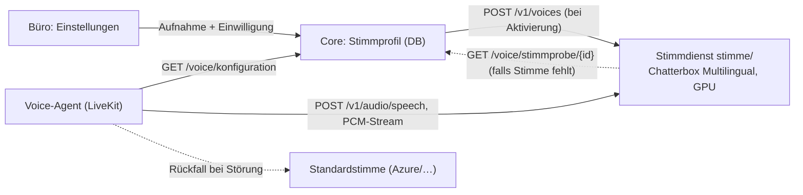

# Eigene Stimme für den Sprachagenten

Der Agent spricht mit einer synthetischen Stimme (TTS). Soll er mit der Stimme des Inhabers (oder einer
Mitarbeiterin) sprechen, wird diese **geklont**: Aus einer kurzen Aufnahme entsteht ein Stimmmodell, das
jeden Text in dieser Stimme ausgibt. Seit Runde 12 läuft das **selbst gehostet** auf dem eigenen Server
(Stimmdienst `stimme/`, Compose-Profil `stimme`), je Mandant mit dokumentierter Einwilligung. Externe
Anbieter (ElevenLabs, Cartesia, Azure Custom Neural Voice) bleiben als Alternative über `TTS_ANBIETER`.

## Ablauf für den Betrieb

1. **Einstellungen → Stimme des Sprachagenten**: Name und Rolle der sprechenden Person, Aufnahme hochladen
   (20–60 s WAV oder FLAC), Einwilligungstext bestätigen, „Stimmprofil anlegen“. Das Profil ist sofort aktiv.
2. **Hörprobe**: Beliebigen Satz eingeben; der Stimmdienst erzeugt ihn in der geklonten Stimme.
3. Ab dem nächsten Anruf spricht der Agent mit dieser Stimme und sagt zu Beginn: „… ein KI-System, das mit der
   nachgebildeten Stimme von <Name> spricht.“
4. **Widerruf**: „Widerrufen und löschen“ entfernt die Aufnahme sofort aus der Datenbank und die Stimme aus dem
   Stimmdienst; der Profilsatz bleibt ohne Audio als Nachweis (wer, wann, welcher Text). Der Agent nutzt wieder
   die Standardstimme.

Pro Mandant ist genau ein Profil aktiv; weitere Profile (z. B. Vertretung) bleiben bereit und lassen sich umschalten.
Die Funktion gehört zu den Editionen Pro und Enterprise (`eigene_stimme`); in Starter bleiben Profile gespeichert,
der Agent spricht mit der Standardstimme.

## Aufnahme

- **Umfang:** 20–60 Sekunden reichen für den Zero-Shot-Klon (mindestens 5 s, höchstens 3 min, 15 MB).
- **Inhalt:** normale Gesprächssprache aus dem Betriebsalltag, nicht vorgelesen klingend: Begrüßung,
  Terminabsprache, Rückfrage, Zahlen und Uhrzeiten, ein Fachbegriff. Keine zweite Stimme, keine Musik.
- **Technik:** ruhiger Raum ohne Hall, 20–30 cm Abstand zum Mikrofon (Headset oder USB-Mikrofon), 44,1 oder
  48 kHz, WAV oder FLAC, kein Rauschfilter. Das Smartphone-Diktiergerät ist in Ordnung, wenn es WAV/FLAC liefert
  (MP3 und OGG werden angenommen, Dauer wird dann nicht geprüft).
- **Tonlage:** so sprechen, wie der Agent klingen soll: freundlich, ruhig, mittleres Tempo. Der Klon übernimmt
  Stimmung und Tempo der Aufnahme.

## Technik



- **Modell:** [Chatterbox Multilingual](https://github.com/resemble-ai/chatterbox) von Resemble AI, MIT-Lizenz
  (Code und Gewichte), 23 Sprachen inkl. Deutsch, Zero-Shot-Klon aus wenigen Sekunden, 24 kHz. Jede Ausgabe
  trägt das unhörbare **Perth-Wasserzeichen**; damit ist synthetische Sprache maschinenlesbar gekennzeichnet
  (Art. 50 Abs. 2 KI-VO). Paket `chatterbox-tts` (`requirements-stimme.txt`), Lizenztext
  `drittanbieter/lizenzen/chatterbox.txt`. Geprüft und verworfen: XTTS v2 (Coqui Public Model License, nicht
  kommerziell), Fish Speech/OpenAudio (CC-BY-NC-SA), F5-TTS (Gewichte auf CC-BY-NC-Daten), IndexTTS 2
  (Gewichte nicht kommerziell). Qwen3-TTS (Apache-2.0, Deutsch) ist eine mögliche zweite Engine; die
  Schnittstelle `stimme/engines.py` ist dafür ausgelegt.
- **Stimmdienst** (`stimme/server.py`): OpenAI-kompatible Schnittstelle (`POST /v1/audio/speech` mit
  `voice=<Profil-ID>`, `response_format=pcm|wav`; `GET/POST/DELETE /v1/voices`; `GET /health`), Schlüssel
  `STIMME_API_KEY` (Bearer oder `X-API-Key`). Synthese satzweise und gestreamt, damit die erste Silbe früh beim
  Anrufer ist; ein Modell, eine Synthese zur Zeit (GPU-Speicher). Unbekannte Stimmen holt der Dienst einmalig
  vom Core (`GET /voice/stimmprobe/{id}`, nur mit Maschinenschlüssel, nur aktive Profile), sodass ein Neustart
  ohne Volume nichts verliert. Audio wird nicht protokolliert. `STIMME_ENGINE=test` liefert einen Sinuston ohne
  Modell (CI, Inbetriebnahme ohne GPU).
- **Agent** (`voice/agent.py`): `tts_erzeugen(stimme)` baut `openai.TTS(base_url=STIMME_URL/v1, voice=<Profil-ID>,
  response_format="pcm")` und legt die Standardstimme als `FallbackAdapter` dahinter: Fällt der Stimmdienst
  aus, spricht der Agent weiter, nur mit der Standardstimme. Die Begrüßung kommt aus `GET /voice/konfiguration`
  und nennt die nachgebildete Stimme.
- **Hardware:** NVIDIA-GPU mit ≥ 8 GB (z. B. Hetzner GEX44 oder eine GPU-Instanz in DE); auf CPU läuft es
  (`STIMME_GERAET=cpu`), aber mit mehreren Sekunden je Satz nur für Tests. Erste Silbe auf einer RTX-4000-Klasse
  typisch 0,3–0,6 s. Das Modell (≈ 2–3 GB) liegt im Volume `stimme-modelle`; für Offline-Betrieb vorab füllen.

## Einrichtung auf dem Server

```
# .env
STIMME_URL=http://127.0.0.1:8300        # aus Sicht von Core und Voice-Agent (network_mode host); im Compose-Netz http://stimme:8300
STIMME_API_KEY=<langer Zufallswert>
STIMME_ENGINE=chatterbox
STIMME_GERAET=auto                      # cuda | cpu | auto

docker compose --profile voice --profile stimme up -d --build stimme core voice-agent
python -m voice.probe                   # zeigt „Stimmdienst (eigene Stimme) OK … chatterbox auf cuda“
```

Voraussetzung für GPU im Container: NVIDIA-Treiber und NVIDIA Container Toolkit auf dem Host (`nvidia-smi`
im Container sichtbar). Ohne GPU `STIMME_GERAET=cpu` setzen und den `deploy:`-Block in `docker-compose.yml`
entfernen oder per Override leeren.

## Rechtliches und Einwilligung (Hinweise, keine Rechtsberatung)

- Die Stimme ist ein personenbezogenes Datum (Art. 4 Nr. 1 DSGVO); die Erstellung eines Stimmmodells ist
  eine Verarbeitung, die sich auf die **Einwilligung** der sprechenden Person stützt (Art. 6 Abs. 1 lit. a,
  Art. 7 DSGVO; bei biometrischer Auswertung Art. 9 Abs. 2 lit. a). Der Einwilligungstext wird je Profil mit
  Name, Betrieb, Datum und entgegennehmender Person gespeichert (`stimmprofil.einwilligung_*`) und steht im
  Ereignisprotokoll (`stimme.angelegt`).
- **Freiwilligkeit im Arbeitsverhältnis** (§ 26 Abs. 2 BDSG): Bei Mitarbeitenden Einwilligung schriftlich,
  ohne Nachteil bei Verweigerung; Widerruf jederzeit über die Oberfläche, Löschung sofort.
- **Offenlegung:** Der Agent sagt zu Beginn, dass eine KI spricht (Art. 50 Abs. 1 KI-VO) und mit wessen
  nachgebildeter Stimme; der Prompt verbietet, sich als diese Person auszugeben. Die Ausgabe ist mit Wasserzeichen
  gekennzeichnet (Art. 50 Abs. 2 KI-VO). Begrüßungstext anpassbar über die Stammdaten `begruessung` und
  `begruessung_stimme` (Platzhalter `{betrieb}`, `{sprecher}`).
- **Verarbeitungsort:** alles auf dem eigenen Server in Deutschland; keine Übermittlung an Dritte. In das
  Verzeichnis der Verarbeitungstätigkeiten (`recht/VVT.md`) aufnehmen; AVV mit dem Betreiber (KUHN) deckt die
  Auftragsverarbeitung ab.
- **Missbrauchsschutz:** Nur Personen mit Recht „verwalten“ legen Profile an; die Aufnahme ist nur mit
  Anmeldung abrufbar, der Stimmdienst nur mit Schlüssel und nur aus dem Compose-Netz bzw. localhost erreichbar.

## Externe Anbieter (Alternative ohne eigene GPU)

| Anbieter | Verfahren | Deutsch | Latenz (erste Silbe) | Datenverarbeitung |
| --- | --- | --- | --- | --- |
| **ElevenLabs** (`TTS_ANBIETER=elevenlabs`) | Instant Voice Clone (1–3 min) oder Professional (30 min+) | sehr gut, `eleven_flash_v2_5` | ca. 75–150 ms | USA/EU je Vertrag, DPA verfügbar |
| **Cartesia** (`cartesia`) | Instant Clone ab ca. 10 s, Modell Sonic | gut | ca. 40–90 ms | USA, DPA verfügbar |
| **Azure Custom Neural Voice** (`azure`) | Aufnahmeskript (300–2000 Sätze), Freigabe durch Microsoft | sehr gut | ca. 150–300 ms | EU-Region, AVV im Microsoft-Vertrag |

Konfiguration wie bisher über `TTS_ANBIETER`, `TTS_STIMME`, `ELEVEN_API_KEY`/`CARTESIA_API_KEY`/`AZURE_TTS_ENDPOINT_ID`;
sie wirkt dann als Standardstimme für alle Mandanten des Workers, während das Stimmprofil je Mandant Vorrang hat.

## Kosten (Größenordnung)

Eigener Stimmdienst: GPU-Server ab ca. 180–220 € je Monat (teilbar über alle Mandanten, ein Modell bedient
viele Stimmen nacheinander), keine Kosten je Zeichen. ElevenLabs Creator/Pro ab ca. 20–100 € je Monat inkl.
Zeichenkontingent; Azure Custom Neural Voice: Training ab ca. 50 € je Stunde, Hosting ca. 4 € je Stunde und
Modell, Synthese ca. 20–25 € je 1 Mio. Zeichen. Ein Telefonat mit 2 Minuten Agentensprache entspricht etwa
1.500–2.000 Zeichen.
