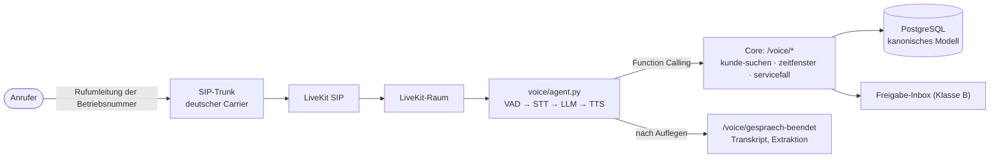

# Voice-Agent: Auswahl und Backend

## Entscheidung

**Selbst betriebener Agent auf LiveKit Agents** (Apache-2.0), angebunden über LiveKit SIP an einen
SIP-Trunk eines deutschen Carriers. Die SaaS-Variante (Retell, Vapi, telli) bleibt über dieselbe
Tool-API anschließbar, weil die gesamte Geschäftslogik im Core-Service liegt.

| Kriterium | LiveKit Agents (gewählt) | Pipecat | Voice-SaaS (Retell, Vapi, telli) |
| --- | --- | --- | --- |
| Anpassbarkeit an Kundenbedarf | voll: eigener Code je Gesprächsschritt, eigene Tools | voll | Prompt und Webhook-Tools, Logik beim Anbieter |
| Telefonie | eigenes SIP-Gateway (LiveKit SIP) | über Daily, Twilio, Telnyx | inklusive |
| Datenhoheit / Hosting DE | vollständig selbst betreibbar | weitgehend | anbieterabhängig, oft USA |
| Austausch STT/TTS/LLM | Plugins, je eine Zeile | Plugins | eingeschränkt |
| Turn-Taking, Barge-in | integriert (VAD, Turn Detection) | integriert | integriert, sehr ausgereift |
| Aufwand bis zum ersten Anruf | mittel (Server, SIP, Keys) | mittel | gering |
| Kosten je Minute | nur STT/TTS/LLM + Carrier | wie LiveKit | Plattformaufschlag |

Begründung: Für ein Produkt, dessen Wert in der Anpassung an Betriebsabläufe liegt, ist die
Kontrolle über den Gesprächsablauf entscheidend. Die Architektur sah Voice-SaaS für den MVP vor;
das bleibt für den allerersten Pilot legitim (geringerer Betriebsaufwand), der Code ist aber auf
Eigenbetrieb ausgerichtet.

## Aufbau

Prinzipien:
- **Der Core entscheidet, der Agent formuliert.** Dringlichkeit, Sicherheitsfälle (Gasgeruch),
  Qualifikationen und Freigabepflichten sind deterministische Regeln im Core (`core/regeln.py`,
  `core/domaene.py`), nicht Teil des Prompts.
- **Keine verbindliche Zusage ohne Freigabe.** Ein im Telefonat gewählter Termin ist Klasse B:
  vorgemerkt, verbindlich erst nach Büro-Freigabe oder per Mandanten-Policy `termin_bestaetigen: auto`.
- **KI-Transparenz** in der Begrüßung (Art. 50 KI-Verordnung); Audio wird nicht aufgezeichnet,
  nur das Transkript übergeben (`aufzeichnung_eingewilligt` steuert Ausnahmen).

## Werkzeuge des Agenten

| Werkzeug | Core-Endpunkt | Zweck |
| --- | --- | --- |
| `kunde_suchen` | `POST /voice/kunde-suchen` | Anrufer per Rufnummer erkennen, Anlagen und offene Vorgänge |
| `zeitfenster_abfragen` | `POST /voice/zeitfenster` | Dringlichkeit, Sicherheitsfall, freie Termine mit passender Qualifikation |
| `servicefall_anlegen` | `POST /voice/servicefall` | Kunde/Anlage anlegen falls neu, Servicefall, Terminvormerkung |
| `rueckruf_vormerken` | `POST /voice/servicefall` | Rückrufwunsch als Vorgang |
| (automatisch) | `POST /voice/gespraech-beendet` | Transkript und Notizen an den Vorgang |

## Inbetriebnahme

1. `.env` aus `.env.example` anlegen, LiveKit-Schlüsselpaar wählen und in `deploy/livekit/sip.yaml` eintragen.
2. `docker compose --profile voice up -d`; Mandant anlegen (`POST /mandanten`), ID als `CORE_MANDANT` setzen.
3. SIP-Trunk beim Carrier buchen; dessen Zieladresse auf die öffentliche IP des Servers (Port 5060/UDP) setzen.
4. Mit der LiveKit-CLI `lk`: `lk sip inbound create deploy/livekit/inbound-trunk.json` und
   `lk sip dispatch create deploy/livekit/dispatch-rule.json` (Format laut aktueller LiveKit-Dokumentation prüfen).
5. Betriebsnummer bei Nichterreichen bzw. außerhalb der Bürozeit auf die Trunk-Nummer umleiten.

Lokal ohne Telefon: `python -m voice.agent dev` und im LiveKit Agents Playground per Browser sprechen.

## Offen

- Latenzmessung Ende-zu-Ende (Ziel unter 1 s bis zur ersten Silbe) mit der gewählten STT/TTS-Kombination.
- Eval-Set aus echten Pilotgesprächen (Extraktion, Terminwahl), analog zum UAT des PV-Prototyps.
- Notdienst-Weiterleitung an eine Bereitschaftsnummer (`ctx.transfer_sip_participant`).
